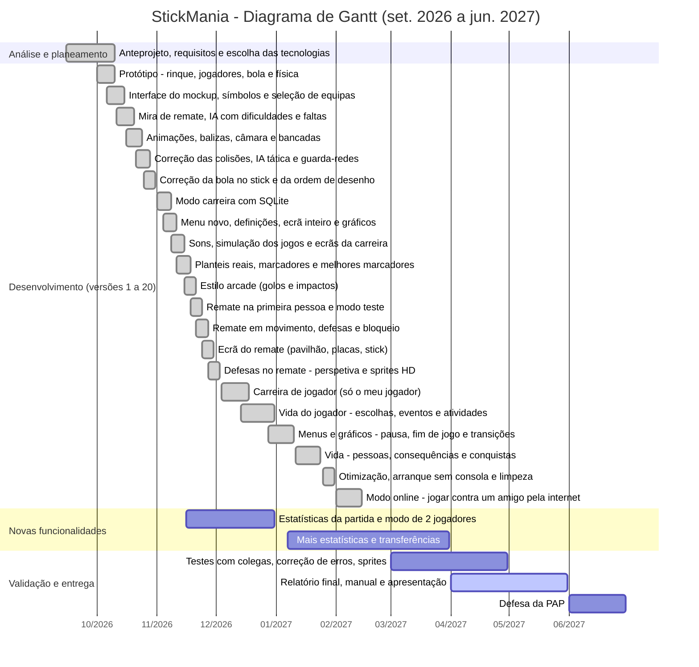

# Diagrama de Gantt — StickMania

Planeamento do projeto da PAP, de setembro de 2026 a junho de 2027. O GitHub desenha o diagrama
a partir do código Mermaid abaixo. As barras escuras são tarefas concluídas, as realçadas estão
em curso e as claras estão planeadas.

> Este ficheiro é gerado pelo script [`docs/diagramas/gerar_gantt.py`](diagramas/gerar_gantt.py),
> o mesmo que faz a imagem do relatório ([`09_gantt.png`](diagramas/09_gantt.png)): os dois têm
> sempre as mesmas datas.

## Tarefas

| N.º | Fase | Tarefa | Início | Fim | Estado |
|---|---|---|---|---|---|
| 1 | Análise e planeamento | Anteprojeto, requisitos e escolha das tecnologias | 15/09/2026 | 10/10/2026 | Concluído |
| 2 | Desenvolvimento (versões 1 a 20) | Protótipo: rinque, jogadores, bola e física | 01/10/2026 | 10/10/2026 | Concluído |
| 3 | Desenvolvimento (versões 1 a 20) | Interface do mockup, símbolos e seleção de equipas | 06/10/2026 | 15/10/2026 | Concluído |
| 4 | Desenvolvimento (versões 1 a 20) | Mira de remate, IA com dificuldades e faltas | 11/10/2026 | 20/10/2026 | Concluído |
| 5 | Desenvolvimento (versões 1 a 20) | Animações, balizas, câmara e bancadas | 16/10/2026 | 24/10/2026 | Concluído |
| 6 | Desenvolvimento (versões 1 a 20) | Correção das colisões, IA tática e guarda-redes | 21/10/2026 | 28/10/2026 | Concluído |
| 7 | Desenvolvimento (versões 1 a 20) | Correção da bola no stick e da ordem de desenho | 25/10/2026 | 31/10/2026 | Concluído |
| 8 | Desenvolvimento (versões 1 a 20) | Modo carreira com SQLite | 01/11/2026 | 08/11/2026 | Concluído |
| 9 | Desenvolvimento (versões 1 a 20) | Menu novo, definições, ecrã inteiro e gráficos | 04/11/2026 | 11/11/2026 | Concluído |
| 10 | Desenvolvimento (versões 1 a 20) | Sons, simulação dos jogos e ecrãs da carreira | 08/11/2026 | 15/11/2026 | Concluído |
| 11 | Desenvolvimento (versões 1 a 20) | Planteis reais, marcadores e melhores marcadores | 11/11/2026 | 18/11/2026 | Concluído |
| 12 | Desenvolvimento (versões 1 a 20) | Estilo arcade (golos e impactos) | 15/11/2026 | 21/11/2026 | Concluído |
| 13 | Desenvolvimento (versões 1 a 20) | Remate na primeira pessoa e modo teste | 18/11/2026 | 24/11/2026 | Concluído |
| 14 | Desenvolvimento (versões 1 a 20) | Remate em movimento, defesas e bloqueio | 21/11/2026 | 27/11/2026 | Concluído |
| 15 | Desenvolvimento (versões 1 a 20) | Ecrã do remate (pavilhão, placas, stick) | 24/11/2026 | 30/11/2026 | Concluído |
| 16 | Desenvolvimento (versões 1 a 20) | Defesas no remate: perspetiva e sprites HD | 27/11/2026 | 03/12/2026 | Concluído |
| 17 | Desenvolvimento (versões 1 a 20) | Carreira de jogador (só o meu jogador) | 04/12/2026 | 18/12/2026 | Concluído |
| 18 | Desenvolvimento (versões 1 a 20) | Vida do jogador: escolhas, eventos e atividades | 14/12/2026 | 31/12/2026 | Concluído |
| 19 | Desenvolvimento (versões 1 a 20) | Menus e gráficos: pausa, fim de jogo e transições | 28/12/2026 | 10/01/2027 | Concluído |
| 20 | Desenvolvimento (versões 1 a 20) | Vida: pessoas, consequências e conquistas | 11/01/2027 | 24/01/2027 | Concluído |
| 21 | Desenvolvimento (versões 1 a 20) | Otimização, arranque sem consola e limpeza | 25/01/2027 | 31/01/2027 | Concluído |
| 22 | Desenvolvimento (versões 1 a 20) | Modo online: jogar contra um amigo pela internet | 01/02/2027 | 14/02/2027 | Concluído |
| 23 | Novas funcionalidades | Estatísticas da partida e modo de 2 jogadores | 16/11/2026 | 31/12/2026 | Planeado |
| 24 | Novas funcionalidades | Mais estatísticas e transferências | 07/01/2027 | 31/03/2027 | Planeado |
| 25 | Validação e entrega | Testes com colegas, correção de erros, sprites | 01/03/2027 | 30/04/2027 | Planeado |
| 26 | Validação e entrega | Relatório final, manual e apresentação | 01/04/2027 | 31/05/2027 | Em curso |
| 27 | Validação e entrega | Defesa da PAP | 01/06/2027 | 30/06/2027 | Planeado |
