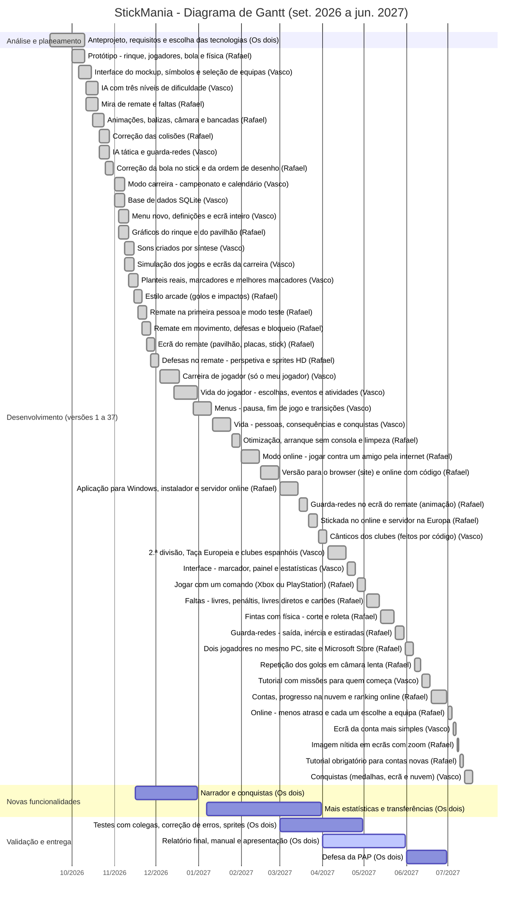

# Diagrama de Gantt — StickMania

Planeamento do projeto da PAP, de setembro de 2026 a junho de 2027. O GitHub desenha o diagrama
a partir do código Mermaid abaixo. As barras escuras são tarefas concluídas, as realçadas estão
em curso e as claras estão planeadas.

**Divisão de tarefas:** o projeto é feito em dupla. Cada tarefa diz entre parênteses quem a fez (Vasco Andreia: 19 tarefas; Rafael da Hora Silveira: 27; os dois: 6). Na imagem do relatório ([`09_gantt.png`](diagramas/09_gantt.png)) a cor de cada barra mostra quem fez a tarefa.

> Este ficheiro é gerado pelo script [`docs/diagramas/gerar_gantt.py`](diagramas/gerar_gantt.py),
> o mesmo que faz a imagem do relatório ([`09_gantt.png`](diagramas/09_gantt.png)): os dois têm
> sempre as mesmas datas.

## Tarefas

| N.º | Fase | Tarefa | Quem fez | Início | Fim | Estado |
|---|---|---|---|---|---|---|
| 1 | Análise e planeamento | Anteprojeto, requisitos e escolha das tecnologias | **Os dois** | 15/09/2026 | 10/10/2026 | Concluído |
| 2 | Desenvolvimento (versões 1 a 37) | Protótipo: rinque, jogadores, bola e física | **Rafael da Hora Silveira** | 01/10/2026 | 10/10/2026 | Concluído |
| 3 | Desenvolvimento (versões 1 a 37) | Interface do mockup, símbolos e seleção de equipas | **Vasco Andreia** | 06/10/2026 | 15/10/2026 | Concluído |
| 4 | Desenvolvimento (versões 1 a 37) | IA com três níveis de dificuldade | **Vasco Andreia** | 11/10/2026 | 20/10/2026 | Concluído |
| 5 | Desenvolvimento (versões 1 a 37) | Mira de remate e faltas | **Rafael da Hora Silveira** | 11/10/2026 | 20/10/2026 | Concluído |
| 6 | Desenvolvimento (versões 1 a 37) | Animações, balizas, câmara e bancadas | **Rafael da Hora Silveira** | 16/10/2026 | 24/10/2026 | Concluído |
| 7 | Desenvolvimento (versões 1 a 37) | Correção das colisões | **Rafael da Hora Silveira** | 21/10/2026 | 28/10/2026 | Concluído |
| 8 | Desenvolvimento (versões 1 a 37) | IA tática e guarda-redes | **Vasco Andreia** | 21/10/2026 | 28/10/2026 | Concluído |
| 9 | Desenvolvimento (versões 1 a 37) | Correção da bola no stick e da ordem de desenho | **Rafael da Hora Silveira** | 25/10/2026 | 31/10/2026 | Concluído |
| 10 | Desenvolvimento (versões 1 a 37) | Modo carreira: campeonato e calendário | **Vasco Andreia** | 01/11/2026 | 08/11/2026 | Concluído |
| 11 | Desenvolvimento (versões 1 a 37) | Base de dados SQLite | **Vasco Andreia** | 01/11/2026 | 08/11/2026 | Concluído |
| 12 | Desenvolvimento (versões 1 a 37) | Menu novo, definições e ecrã inteiro | **Vasco Andreia** | 04/11/2026 | 11/11/2026 | Concluído |
| 13 | Desenvolvimento (versões 1 a 37) | Gráficos do rinque e do pavilhão | **Rafael da Hora Silveira** | 04/11/2026 | 11/11/2026 | Concluído |
| 14 | Desenvolvimento (versões 1 a 37) | Sons criados por síntese | **Vasco Andreia** | 08/11/2026 | 15/11/2026 | Concluído |
| 15 | Desenvolvimento (versões 1 a 37) | Simulação dos jogos e ecrãs da carreira | **Vasco Andreia** | 08/11/2026 | 15/11/2026 | Concluído |
| 16 | Desenvolvimento (versões 1 a 37) | Planteis reais, marcadores e melhores marcadores | **Vasco Andreia** | 11/11/2026 | 18/11/2026 | Concluído |
| 17 | Desenvolvimento (versões 1 a 37) | Estilo arcade (golos e impactos) | **Rafael da Hora Silveira** | 15/11/2026 | 21/11/2026 | Concluído |
| 18 | Desenvolvimento (versões 1 a 37) | Remate na primeira pessoa e modo teste | **Rafael da Hora Silveira** | 18/11/2026 | 24/11/2026 | Concluído |
| 19 | Desenvolvimento (versões 1 a 37) | Remate em movimento, defesas e bloqueio | **Rafael da Hora Silveira** | 21/11/2026 | 27/11/2026 | Concluído |
| 20 | Desenvolvimento (versões 1 a 37) | Ecrã do remate (pavilhão, placas, stick) | **Rafael da Hora Silveira** | 24/11/2026 | 30/11/2026 | Concluído |
| 21 | Desenvolvimento (versões 1 a 37) | Defesas no remate: perspetiva e sprites HD | **Rafael da Hora Silveira** | 27/11/2026 | 03/12/2026 | Concluído |
| 22 | Desenvolvimento (versões 1 a 37) | Carreira de jogador (só o meu jogador) | **Vasco Andreia** | 04/12/2026 | 18/12/2026 | Concluído |
| 23 | Desenvolvimento (versões 1 a 37) | Vida do jogador: escolhas, eventos e atividades | **Vasco Andreia** | 14/12/2026 | 31/12/2026 | Concluído |
| 24 | Desenvolvimento (versões 1 a 37) | Menus: pausa, fim de jogo e transições | **Vasco Andreia** | 28/12/2026 | 10/01/2027 | Concluído |
| 25 | Desenvolvimento (versões 1 a 37) | Vida: pessoas, consequências e conquistas | **Vasco Andreia** | 11/01/2027 | 24/01/2027 | Concluído |
| 26 | Desenvolvimento (versões 1 a 37) | Otimização, arranque sem consola e limpeza | **Rafael da Hora Silveira** | 25/01/2027 | 31/01/2027 | Concluído |
| 27 | Desenvolvimento (versões 1 a 37) | Modo online: jogar contra um amigo pela internet | **Rafael da Hora Silveira** | 01/02/2027 | 14/02/2027 | Concluído |
| 28 | Desenvolvimento (versões 1 a 37) | Versão para o browser (site) e online com código | **Rafael da Hora Silveira** | 15/02/2027 | 28/02/2027 | Concluído |
| 29 | Desenvolvimento (versões 1 a 37) | Aplicação para Windows, instalador e servidor online | **Rafael da Hora Silveira** | 01/03/2027 | 14/03/2027 | Concluído |
| 30 | Desenvolvimento (versões 1 a 37) | Guarda-redes no ecrã do remate (animação) | **Rafael da Hora Silveira** | 15/03/2027 | 21/03/2027 | Concluído |
| 31 | Desenvolvimento (versões 1 a 37) | Stickada no online e servidor na Europa | **Rafael da Hora Silveira** | 22/03/2027 | 28/03/2027 | Concluído |
| 32 | Desenvolvimento (versões 1 a 37) | Cânticos dos clubes (feitos por código) | **Vasco Andreia** | 29/03/2027 | 04/04/2027 | Concluído |
| 33 | Desenvolvimento (versões 1 a 37) | 2.ª divisão, Taça Europeia e clubes espanhóis | **Vasco Andreia** | 05/04/2027 | 18/04/2027 | Concluído |
| 34 | Desenvolvimento (versões 1 a 37) | Interface: marcador, painel e estatísticas | **Vasco Andreia** | 19/04/2027 | 25/04/2027 | Concluído |
| 35 | Desenvolvimento (versões 1 a 37) | Jogar com um comando (Xbox ou PlayStation) | **Rafael da Hora Silveira** | 26/04/2027 | 02/05/2027 | Concluído |
| 36 | Desenvolvimento (versões 1 a 37) | Faltas: livres, penáltis, livres diretos e cartões | **Rafael da Hora Silveira** | 03/05/2027 | 12/05/2027 | Concluído |
| 37 | Desenvolvimento (versões 1 a 37) | Fintas com física: corte e roleta | **Rafael da Hora Silveira** | 13/05/2027 | 23/05/2027 | Concluído |
| 38 | Desenvolvimento (versões 1 a 37) | Guarda-redes: saída, inércia e estiradas | **Rafael da Hora Silveira** | 24/05/2027 | 30/05/2027 | Concluído |
| 39 | Desenvolvimento (versões 1 a 37) | Dois jogadores no mesmo PC, site e Microsoft Store | **Rafael da Hora Silveira** | 31/05/2027 | 06/06/2027 | Concluído |
| 40 | Desenvolvimento (versões 1 a 37) | Repetição dos golos em câmara lenta | **Rafael da Hora Silveira** | 07/06/2027 | 11/06/2027 | Concluído |
| 41 | Desenvolvimento (versões 1 a 37) | Tutorial com missões para quem começa | **Vasco Andreia** | 12/06/2027 | 18/06/2027 | Concluído |
| 42 | Desenvolvimento (versões 1 a 37) | Contas, progresso na nuvem e ranking online | **Rafael da Hora Silveira** | 19/06/2027 | 30/06/2027 | Concluído |
| 43 | Desenvolvimento (versões 1 a 37) | Online: menos atraso e cada um escolhe a equipa | **Rafael da Hora Silveira** | 01/07/2027 | 04/07/2027 | Concluído |
| 44 | Desenvolvimento (versões 1 a 37) | Ecrã da conta mais simples | **Vasco Andreia** | 05/07/2027 | 07/07/2027 | Concluído |
| 45 | Desenvolvimento (versões 1 a 37) | Imagem nítida em ecrãs com zoom | **Rafael da Hora Silveira** | 08/07/2027 | 09/07/2027 | Concluído |
| 46 | Desenvolvimento (versões 1 a 37) | Tutorial obrigatório para contas novas | **Rafael da Hora Silveira** | 10/07/2027 | 12/07/2027 | Concluído |
| 47 | Desenvolvimento (versões 1 a 37) | Conquistas (medalhas, ecrã e nuvem) | **Vasco Andreia** | 13/07/2027 | 19/07/2027 | Concluído |
| 48 | Novas funcionalidades | Narrador e conquistas | **Os dois** | 16/11/2026 | 31/12/2026 | Planeado |
| 49 | Novas funcionalidades | Mais estatísticas e transferências | **Os dois** | 07/01/2027 | 31/03/2027 | Planeado |
| 50 | Validação e entrega | Testes com colegas, correção de erros, sprites | **Os dois** | 01/03/2027 | 30/04/2027 | Planeado |
| 51 | Validação e entrega | Relatório final, manual e apresentação | **Os dois** | 01/04/2027 | 31/05/2027 | Em curso |
| 52 | Validação e entrega | Defesa da PAP | **Os dois** | 01/06/2027 | 30/06/2027 | Planeado |
